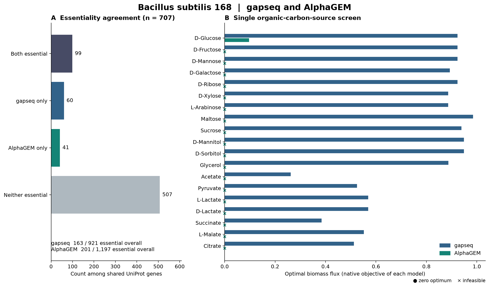

# 枯草芽孢杆菌 168 的 gapseq 与 AlphaGEM 模型比较

目标为枯草芽孢杆菌 *Bacillus subtilis* subsp. *subtilis* 168，分类编号 224308。参考基因组为 GCF_000009045.1（染色体 NC_000964.3），参考蛋白组为 UniProt UP000001570。

本项目使用 Han 等公开发布的两套实际重建产物，完成统一条件的 Python 分析，并导出两套统一培养基的 SBML。上游从序列重新建模的两条流程未在本项目中完整运行。附有独立的 `reconstruct.py` 启动代码和目标序列。分析延续附件 03、04 的逐底物 FBA 与单基因敲除。附件 01、02 中的命令示例由官方 CLI 对应参数替代。

## 模型结构与来源

| 指标 | gapseq | AlphaGEM |
|---|---:|---:|
| 反应 | 2,787 | 2,134 |
| 区室内代谢物条目 | 2,341 | 2,027 |
| 交换反应 | 210 | 339 |
| GPR 非空的反应 | 2,346 | 1,680 |
| 模型基因 | 921 | 1,197 |
| 与参考蛋白组精确匹配的基因 | 921 | 1,158 |
| 葡萄糖基线生物量通量 | 0.923433 | 0.096998 |

gapseq 通过序列比对及通路和转运预测组装反应网络，再对培养基填补缺口。AlphaGEM 使用蛋白结构同源关系从参考 GEM 转移反应和 GPR，并结合酶功能预测补充反应。两套模型的反应命名空间不同。以非边界反应已有的 BiGG 注释统计，gapseq 有 1,984 个不同标签，AlphaGEM 有 1,815 个，**共有 567 个标签**。标签与反应可能多对多，该统计度量的是注释覆盖。逐标签的模型反应对应关系见 `bigg_reaction_overlap.csv`。

两套模型保留各自的生物量目标和维护约束。gapseq 最大化 `EX_cpd11416_c0`。AlphaGEM 最大化源自 iML1515 模板的 `Ec_biomass_iML1515_core_75p37M`，并保留 6.86 的 ATPM 下界。通量数值依赖各自的生物量配方、网络、维护和边界设置。模型大小、预测阳性数量及葡萄糖通量本身无法衡量模型准确率。

## 必需基因与底物预测



- **必需基因。** gapseq 预测 **163 / 921（17.70%）**，AlphaGEM 预测 **201 / 1,197（16.79%）**。AlphaGEM 的 201 项中，196 项最优生物量低于阈值，5 项在原约束下无可行解。两套模型可按参考 UniProt 单一登录号对应的 **707** 个基因中，**99** 个共同预测为必需，**60** 个仅 gapseq 判为必需，**41** 个仅 AlphaGEM 判为必需，**507** 个共同判为非必需。两边判定一致 **606 / 707（85.71%）**。AlphaGEM 中 39 个未与该快照精确匹配的原始基因仍保留在模型内统计。
- **底物利用。** 在 19 种共享交换底物中，gapseq 有 **19 / 19** 项支持生物量合成。AlphaGEM 有 **1 / 19** 项支持生物量，即葡萄糖。其余 18 项在保留默认 ATPM 下界时为无可行解。将 ATPM 下界降为 0 后，这 18 项均有可行解，但最优生物量仍为零。18 种阴性底物中有 16 种（包括果糖、甘油、麦芽糖和乙酸）的胞外代谢物只连接边界反应。开放交换也无法将这些底物供给网络。D-乳酸和琥珀酸连有非边界反应，但在本模型和条件下仍无法支持生物量。
- **对照。** gapseq 关闭所有摄取或去掉有机碳后，最优生物量为零。AlphaGEM 在这两种条件下无可行解。AlphaGEM 的葡萄糖条件分别关闭钼酸盐或镍摄取后，最优生物量也降到零。模型的镍交换表示不同，gapseq 缺少对应的镍交换，此项在共同外部培养条件中隐式不可摄取。

### 分析约束

1. 在 `input/medium.csv` 中预先指定可比的无机或非有机背景。氧摄取上限为 10，CO₂ 为 10；其余按表所列。所有其他模型交换摄取关闭，保留外排。钼酸盐以化学身份配对，模型所用质子化写法存在差异。
2. `input/substrates.csv` 明确对应反应 ID 和碳原子数。统一碳摄取上限为 60 mmol C·gDW⁻¹·h⁻¹，每项有机底物的分子通量上限为 60 除以其碳原子数。生物量通量大于 10⁻⁶ 判为支持生长。不可行与可行零生长在表里分别记录。
3. 葡萄糖是单基因敲除的基线。通过 GPR 关闭失效反应，重算最大生物量；低于各自基线的 1% 判为必需。在强制约束下无可行解也计为必需，并单列求解状态。只用参考蛋白组支持的唯一登录号进行跨模型基因比较。
4. 本项目未使用实测标签计算预测准确率。168 的常见实验室株携带 `trpC2`，分析沿用发布模型的 GPR 及原目标，没有另加等位基因约束或色氨酸补充，因此预测对应上述计算条件。参见 [168 菌株历史与基因型](https://pmc.ncbi.nlm.nih.gov/articles/PMC2580678/)。

## 文件与复现

| 文件 | 用途 |
|---|---|
| `models/gapseq.xml`、`models/alphagem.json` | 作者发布的原始模型快照 |
| `results/models/gapseq_matched.xml`、`results/models/AlphaGEM_matched.xml` | 本项目导出的葡萄糖基线 SBML，可直接载入 COBRApy |
| `input/` | 参考基因组、蛋白 FASTA、登录号映射和培养条件 |
| `analyze.py` | 统一培养条件、FBA、敲除、交叉映射、结果表和绘图 |
| `reconstruct.py` | 使用已配置的上游软件从蛋白 FASTA 发起重建 |
| `results/*.csv` | 原始规模、全部敲除、必需基因清单、共享基因、反应标签、底物、对照及敏感性结果 |
| `results/prediction_summary.png/svg` | 预测结果图 |

解压后进入 `bacillus_gem`，用 Python 3.12 运行已验证的分析入口。

```bash
python -m pip install -r requirements.txt
python analyze.py
```

如在另一个已配置环境复建，按对应官方文档安装 gapseq（论文基准用 v1.4.0）或 AlphaGEM。AlphaGEM 的结构模式另需蛋白结构目录及含 `Entry`、`Entry Name`、`Structure Data` 的 Excel 对照表，Entry 使用 FASTA 中的 UniProt 登录号。AlphaGEM 还需安装作者提供的依赖数据及兼容求解器，当前官方资源归档约 13.1 GB。这些复建命令与本包已完成的分析是两个入口，复建产物也可能需要重新确认交换反应对应表。

```bash
python reconstruct.py gapseq
python reconstruct.py alphagem --repo /path/to/AlphaGEM \
    --structures /path/to/structures --table /path/to/structure_index.xlsx
```

## 来源

- Han et al. (2026), *AlphaGEM enables precise genome-scale metabolic modelling by integrating protein structure alignment with deep-learning-based dark metabolism mining*. [论文](https://doi.org/10.1038/s41467-026-75549-w) · [AlphaGEM 官方 CLI](https://github.com/hongzhonglu/AlphaGEM) · [依赖数据](https://doi.org/10.6084/m9.figshare.30630524)。
- [gapseq 枯草芽孢杆菌模型原文件](https://github.com/HanWeishang/AlphaGEM-figures/blob/816474de3d58755b64b25c83ff8900019a0f325f/models/gapseq/bsubtilis.xml)。Zimmermann et al. (2021) [gapseq 方法论文](https://doi.org/10.1186/s13059-021-02295-1) · [gapseq 用法](https://gapseq.readthedocs.io/en/latest/usage/basics.html)。
- [AlphaGEM 枯草芽孢杆菌重建模型原文件](https://github.com/HanWeishang/AlphaGEM-GEMs-reconstructed/blob/c85832ff5abbbe9b07dac41dffe6f2791299f253/Models/StructureAlignmentMode/bsubtilis-GEM.json)。采用作者主重建库的结构比对 JSON 快照。作者另有一个拓扑不同的分析库 XML，本项目的 AlphaGEM 数字均对应所附 JSON。原模型哈希见 `results/model_summary.csv`。
- [参考基因组 GCF_000009045.1](https://www.ncbi.nlm.nih.gov/datasets/genome/GCF_000009045.1/) · [UniProt 蛋白组 UP000001570](https://www.uniprot.org/proteomes/UP000001570)。附件中保留分析采用的 FASTA 与 TSV 快照。
