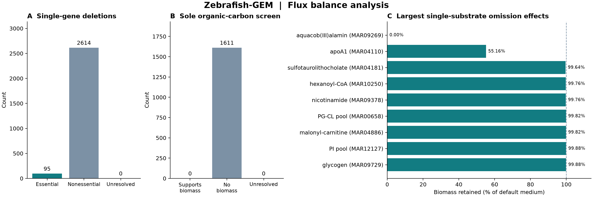

# 斑马鱼全基因组尺度代谢模型与预测

研究对象为斑马鱼 *Danio rerio*（NCBI Taxonomy 7955）。本项目采用已发表的 Zebrafish-GEM，基于附件 03 和 04 的 FBA 思路计算底物效应和单基因敲除。附件 01 和 02 为构建命令演示，提供了方法比较的起点。

## 两种构建方法的差异

| 比较项 | gapseq | AlphaGEM |
|---|---|---|
| 主要输入 | 基因组或蛋白 FASTA | 蛋白 FASTA。结构模式另需蛋白结构文件与 ID 对照表 |
| 功能推断 | 通过序列比对匹配酶与转运蛋白，结合通路覆盖度等信息提出候选反应 | 结构模式通过蛋白结构比对推断同源关系，另有 PLMSearch 模式。论文还使用 DeepECtransformer 扩展酶功能注释 |
| 草模与补全 | 根据通路和转运预测组装反应网络，再根据指定培养基执行缺口填补 | 从参考 GEM 投射基因—蛋白—反应（GPR）规则，再结合功能预测与培养条件补全 |
| 斑马鱼适用性 | 可搜索动物通路，完整模型重建及缺口填补支持细菌和古菌 | 文档给出大肠杆菌、酵母等参考模式，原论文描述了哺乳动物模板。斑马鱼的参考模型、区室、GPR 与生物量约束需要独立验证 |
| 本项目实际产物 | 无斑马鱼重建模型 | 无斑马鱼重建模型 |

附件 02 中的示意命令应以 AlphaGEM 官方仓库的 `AlphaGEM.py` 和数据准备说明为准。在官方论文链接的重建模型仓库所检查的文件树（树对象 `c85832ff5abbbe9b07dac41dffe6f2791299f253`）中未找到以 Danio、rerio 或 zebrafish 命名的文件。由于 gapseq 支持范围和 AlphaGEM 的斑马鱼验证缺口，本项目的工具比较停留在方法层面。反应重叠、GPR 一致性和预测差异需要两套来源明确的同物种 SBML 才能计算。

## 模型与分析条件

- 使用 Wang 等发表的 Zebrafish-GEM。原始 SBML 与 CC BY 4.0 许可保存在 `models/`。提交为 `846f0b7b34701801b2f5e15f549807d2e71ffa62`，SBML 哈希见 `results/summary.json`。
- FBA 采用 SBML 原有的生物量目标 MAR00021。基线沿用原始交换边界。原文件的 1,658 个交换都允许摄取，因此这是宽松的计算参考条件。目标值以模型通量表示，无法直接外推到鱼体生长。
- 逐个对 GPR 中的基因进行敲除并重算最优生物量。最优目标低于基线 1% 时判定为该条件下的模型必需基因。保留求解状态，无法获取最优解的条件单独记录。
- 底物预测采用两项互补检验。逐个开放含碳交换，保留默认无碳摄取与无机碳摄取，每项以 60 个碳原子通量单位为上限，检验能否支持生物量；分子式缺失或无法解析时排除该交换。含 R 基的通用式按式中明确列出的 C 数计量，因此此类底物的上限仅为近似。逐一关闭默认条件中的含碳摄取，保留其他底物，检验模型生物量是否下降。
- 关闭全部摄取、关闭有机碳摄取分别作为阴性对照。单一有机碳条件同时考验全部生物量前体的合成，无法生长可由对其他有机营养物的依赖造成。逐一移除筛查受底物冗余影响，实际生理解释需要组织、发育阶段及实测环境信息。

## 预测结果



模型含 **12,833** 个反应、**8,435** 个分区代谢物和 **2,709** 个模型基因。默认条件下的最优生物量通量为 **4.262828**。关闭全部摄取和关闭有机碳摄取时，生物量通量在数值容差内均为零。

- **必需基因。** 预测出 **95** 个，占模型基因的 **3.51%**。全部敲除得到最优解。完整清单在 `results/essential_genes.csv`，每个基因的求解状态和生物量通量在 `results/gene_deletion.csv`。
- **单一有机碳源。** **0/1,611** 项达到生物量阈值。结果反映了此背景条件下对共同营养供应的依赖。可运输或参与某条代谢通路的有机物，也可能无法单独满足生物量合成。所有条件见 `results/sole_organic_carbon.csv`。
- **逐一关闭摄取。** **9/1,611** 项的最优生物量下降超过数值容差。apoA1 和脂质池属于模型交换定义，表中的敏感性只适用于所设交换边界。

| 移除的交换代谢物 | 反应 ID | 保留的生物量 |
|---|---|---:|
| aquacob(III)alamin | `MAR09269` | 0.00% |
| apoA1 | `MAR04110` | 55.16% |
| sulfotaurolithocholate | `MAR04181` | 99.64% |
| hexanoyl-CoA | `MAR10250` | 99.76% |
| nicotinamide | `MAR09378` | 99.76% |
| PG-CL pool | `MAR00658` | 99.82% |
| malonyl-carnitine | `MAR04886` | 99.82% |
| PI pool | `MAR12127` | 99.88% |
| glycogen | `MAR09729` | 99.88% |

`results/exchanges.csv` 记录交换反应、分子式和原始摄取界限。图中 A、B 分别统计基因与单一有机碳筛查的分类，C 显示超过变化阈值的移除条件，虚线为默认条件的 100%。汇总数值与版本信息见 `results/summary.json`。

## 复现

在解压目录进入 `zebrafish_gem`，使用 Python 3.12。

```bash
python -m pip install -r requirements.txt
python analyze_gem.py --model models/Zebrafish-GEM.xml --out results
```

## 来源

- Wang et al. (2021). *Genome-scale metabolic network reconstruction of model animals as a platform for translational research*. https://doi.org/10.1073/pnas.2102344118
- Zebrafish-GEM 固定版本。https://github.com/SysBioChalmers/Zebrafish-GEM/tree/846f0b7b34701801b2f5e15f549807d2e71ffa62
- gapseq 官方 FAQ。https://github.com/jotech/gapseq/blob/master/docs/faq.md
- Han et al. (2026). *AlphaGEM enables precise genome-scale metabolic modelling by integrating protein structure alignment with deep-learning-based dark metabolism mining*. https://doi.org/10.1038/s41467-026-75549-w
- AlphaGEM 官方仓库与重建模型。https://github.com/hongzhonglu/AlphaGEM · https://github.com/HanWeishang/AlphaGEM-GEMs-reconstructed
